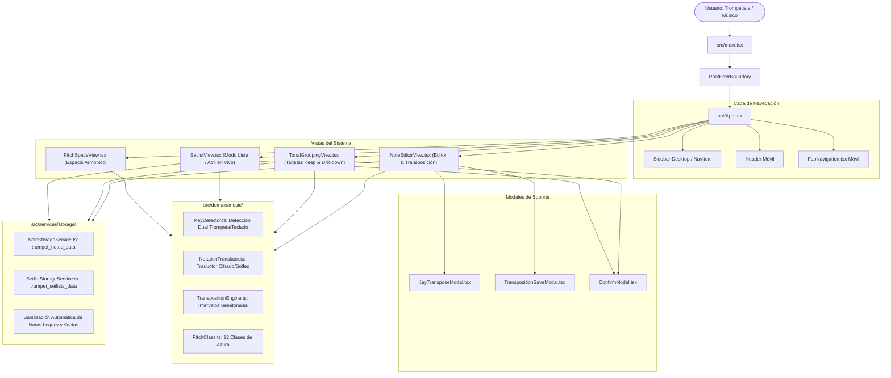

# AUDITORÍA TÉCNICA Y ARQUITECTURA DE SOFTWARE: TNOTES
**Proyecto:** TNotes (Trumpet Notes & Repertorio Musical)  
**Ruta Absoluta Verificada:** `d:\codigos python (A,VS,C)\TNotes`  
**Fecha de Auditoría:** 21 de Octubre de 2026  
**Auditor:** Arquitecto de Software Senior y Desarrollador Experto  
**Estado de Git:** Rama `main` (Limpia, sincronizada con `origin/main` en commit `3bfc8fe`)  

---

## 1. RESUMEN EJECUTIVO

TNotes es una Progressive Web App (PWA) de alto rendimiento, orientada a músicos y trompetistas (especialmente en contextos de ensambles, alabanza y música en vivo). Resuelve la necesidad crítica de lectura, edición, organización por tonalidades y transposición en tiempo real entre instrumentos afinados en **Si bemol (Bb)** (como la trompeta) y tonalidades de concierto en **Do** (teclado, piano, bajo, guitarra).

### Conclusiones Principales:
1. **Calidad de Compilación y Tipado:** La base de código cuenta con una salud técnica excepcional en su capa activa:
   - **Pruebas Automatizadas:** 51/51 pruebas unitarias y de dominio ejecutadas con éxito con Vitest (`npm test -- --run`).
   - **Verificación de Tipos:** 0 errores de compilación estricta con TypeScript (`npm run lint` / `tsc --noEmit`).
   - **Empaquetado de Producción:** Vite v8.3.4 compila limpiamente en 15.7s generando un bundle hiperligero de solo **295 kB** de JavaScript y **66 kB** de CSS.
2. **Arquitectura Offline-First Determinista:** Aunque existen librerías de backend (`firebase`, `express`), el núcleo operativo de la aplicación es 100% offline-first y reside en el cliente. Utiliza `localStorage` con sanitización preventiva automática y un motor musical determinista (`src/domain/music/`) desacoplado de la interfaz gráfica.
3. **Coexistencia de Código Heredado (Deuda Técnica):** Se detectó la coexistencia de componentes huérfanos del primer prototipo (`NotesFeedView.tsx`, `RoutinesView.tsx`, `EtudesView.tsx`, `ValvesView.tsx`, `MetronomeDroneWidget.tsx`, `TunerModal.tsx`, y un `NoteEditorView.tsx` duplicado en `src/components/`). La aplicación activa montada en `App.tsx` utiliza exclusivamente la jerarquía modular dentro de `src/components/views/`.

---

## 2. STACK TECNOLÓGICO Y DEPENDENCIAS

- **Plataforma:** Web Móvil / Desktop PWA instalable (`manifest.json` y `sw.js`).
- **Librería de UI:** React 19.0.1 (`react`, `react-dom`).
- **Lenguaje:** TypeScript 7.0.2 / 5.x (Strict Mode).
- **Estilos:** Tailwind CSS 4.3.3 integrado con `@tailwindcss/vite` (sin dependencias de PostCSS tradicionales).
- **Animaciones e Iconos:** Lucide React 0.546.0, Motion (Framer Motion) 12.23.24.
- **Empaquetador y Dev Server:** Vite 8.3.0 (`@vitejs/plugin-react` 6.1.1).
- **Framework de Pruebas:** Vitest 5.0.3.
- **Persistencia en Producción:** `localStorage` nativo con serialización segura y tolerante a fallos (`NoteStorageService.ts`, `SetlistStorageService.ts`).
- **Motor de Audio:** Web Audio API nativo (`TrumpetAudioEngine.ts` con osciladores y filtros bipolares).
- **Dependencias Secundarias / Latentes:** Firebase 13.0.0, Express 4.21.2, `@google/genai` 2.4.0 (presentes en `package.json` para sincronización futura en la nube, pero no requeridas en el runtime local principal).

---

## 3. ARQUITECTURA Y FLUJO DE DATOS



---

## 4. MAPA DE ARCHIVOS PRINCIPALES Y RESPONSABILIDADES

### A. Vistas Activas (Runtime)
- [src/App.tsx](file:///d:/codigos%20python%20(A,VS,C)/TNotes/src/App.tsx): Orquestador principal de estado global: vista activa (`grouping`, `editor`, `setlist`, `pitch-space`), tema claro/oscuro, sistema de notación (`en` / `natural`), control de nota activa y refresco reactivo.
- [src/components/views/TonalGroupingView.tsx](file:///d:/codigos%20python%20(A,VS,C)/TNotes/src/components/views/TonalGroupingView.tsx): Catálogo de canciones agrupadas por tono en tarjetas dinámicas estilo Google Keep. Muestra cabeceras duales en paralelo (`🎺 RE Menor | 🎹 DO Menor`), vista previa de 4 canciones y modo drill-down para inspeccionar todas las canciones del tono.
- [src/components/views/NoteEditorView.tsx](file:///d:/codigos%20python%20(A,VS,C)/TNotes/src/components/views/NoteEditorView.tsx): Editor de canciones con detección de tono dual en tiempo real, cambio de notación (Cifrado Inglés vs Solfeo Latino), teclado virtual musical en pantalla, cursor caret y transposición modal.
- [src/components/views/SetlistView.tsx](file:///d:/codigos%20python%20(A,VS,C)/TNotes/src/components/views/SetlistView.tsx): Modo Lista / Atril en vivo. Permite crear listas para servicios dominicales o ensayos, ordenar canciones, transponerlas para el concierto y visualizarlas con texto enriquecido (`*intro*`, `*coro*`).
- [src/components/views/PitchSpaceView.tsx](file:///d:/codigos%20python%20(A,VS,C)/TNotes/src/components/views/PitchSpaceView.tsx): Rueda cromática armónica interactiva y tabla comparativa de transposición paso a paso (+2 semitonos).

### B. Motor de Dominio Musical (`src/domain/music/`)
- [KeyDetector.ts](file:///d:/codigos%20python%20(A,VS,C)/TNotes/src/domain/music/KeyDetector.ts): Algoritmo de detección tonal heurística basada en frecuencias, notas de entrada y tónicas de reposo final. Retorna simultáneamente `trumpetKey` y `concertKey` (-2 semitonos).
- [NotationTranslator.ts](file:///d:/codigos%20python%20(A,VS,C)/TNotes/src/domain/music/NotationTranslator.ts): Traductor universal de texto completo (Inglés <-> Solfeo) que respeta anotaciones entre asteriscos y separadores de compás.
- [TranspositionEngine.ts](file:///d:/codigos%20python%20(A,VS,C)/TNotes/src/domain/music/TranspositionEngine.ts): Transposición cromática pura por semitonos sobre cadenas de texto y nombres de tonalidad.

### C. Persistencia y Almacenamiento Local (`src/services/storage/`)
- [NoteStorageService.ts](file:///d:/codigos%20python%20(A,VS,C)/TNotes/src/services/storage/NoteStorageService.ts): CRUD de canciones en `localStorage` con claves primarias y de respaldo (`trumpet_notes_data`, `tnotes_songs_v1`), sanitización preventiva al vuelo y traducción retroactiva de toda la biblioteca.
- [SetlistStorageService.ts](file:///d:/codigos%20python%20(A,VS,C)/TNotes/src/services/storage/SetlistStorageService.ts): CRUD y ordenamiento de listas de reunión en `trumpet_setlists_data`.

### D. Componentes Huérfanos / Desconectados (Deuda Técnica)
- `src/components/NoteEditorView.tsx` (duplicado en la raíz de components; no se importa).
- `src/components/NotesFeedView.tsx` (vista feed de prototipo anterior).
- `src/components/RoutinesView.tsx`, `EtudesView.tsx`, `ValvesView.tsx` (ejercicios y digitación de válvulas desvinculados).
- `src/components/MetronomeDroneWidget.tsx`, `TunerModal.tsx` (herramientas acústicas sin botón de apertura en el layout actual).
- `src/controllers/NoteEditorController.ts` y `src/services/firebase/NoteRepository.ts` (capa previa orientada a Firestore).

---

## 5. INVENTARIO Y ESTADO DE FUNCIONALIDADES

| Funcionalidad | Descripción y Alcance | Estado | Cobertura / Pruebas |
| :--- | :--- | :--- | :--- |
| **Detección Tonal Dual** | Reconoce tonos mayores y menores en cifrado inglés y solfeo; calcula par trompeta vs concierto. | **IMPLEMENTADA Y VERIFICADA** | 8 pruebas en `KeyDetector.test.ts` |
| **Traducción Universal de Notación** | Conmutación instantánea entre C, D, E y Do, Re, Mi preservando estructura. | **IMPLEMENTADA Y VERIFICADA** | 16 pruebas en `NotationAndTranspositionAssistant.test.ts` |
| **Traducción Retroactiva de Base de Datos** | Al pulsar el botón global de notación, traduce todo el repertorio en almacenamiento. | **IMPLEMENTADA Y VERIFICADA** | Verificada en runtime |
| **Catálogo Keep con Drill-down** | Grid responsivo de tarjetas por tonalidad con cabecera dual y vista enfocada de canciones. | **IMPLEMENTADA Y VERIFICADA** | Verificada en runtime y build |
| **Editor de Alabanzas con Barra Musical** | Pad de escritura con caret virtual, teclado musical en pantalla y botones de notas. | **IMPLEMENTADA Y VERIFICADA** | Verificada en runtime |
| **Transposición en Tiempo Real** | Transposición interválica con opción de guardar tono base o solo transponer para tocar. | **IMPLEMENTADA Y VERIFICADA** | 16 pruebas en `MusicalDomain.test.ts` |
| **Modo Lista (Atril en Vivo)** | Creación y administración de listas para culto/ensayo con visualización limpia de notas. | **IMPLEMENTADA Y VERIFICADA** | 11 pruebas en `SetlistAndTransposition.test.ts` |
| **Rueda Cromática y Mapeo Armónico** | Espacio armónico visual que resalta las notas de la escala activa. | **IMPLEMENTADA Y VERIFICADA** | Verificada en runtime |
| **Soporte PWA y Offline** | Instalación como app nativa móvil y caché de shell con Service Worker. | **IMPLEMENTADA Y VERIFICADA** | Configurado en `main.tsx` y `manifest.json` |
| **Sanitización Automática de Datos** | Corrige notas antiguas sin instrumento y purga notas vacías residuales. | **IMPLEMENTADA Y VERIFICADA** | Verificada en `NoteStorageService.ts` |
| **Metrónomo y Generador de Tonos (Drone)** | Síntesis Web Audio para click de metrónomo y tono de referencia A=440Hz. | **PARCIALMENTE IMPLEMENTADA** | Servicio funcional, pero UI desconectada del menú principal |
| **Sincronización en la Nube (Firebase)** | Persistencia remota multi-dispositivo con Firebase Firestore. | **NO IMPLEMENTADA / LATENTE** | Clases existen pero están inactivas |

---

## 6. MODELOS DE DATOS Y CONTRATOS

### Entidades en `src/types/note.ts`

```typescript
export interface SongNote {
  id: string;
  title: string;
  content: string;
  activeInstrument: 'keyboard' | 'trumpet'; // Define la perspectiva de digitación base
  detectedKey: string;                      // Clave de lectura de trompeta (Bb)
  concertKey?: string;                     // Clave de concierto / teclado (Do)
  updatedAt: number;
}

export interface Setlist {
  id: string;
  name: string;      // Nombre de la lista (ej: "Culto Domingo Mañana")
  songIds: string[]; // Lista ordenada de IDs de canciones
  updatedAt: number;
}
```

### Claves en `localStorage`:
- `trumpet_notes_data`: Array JSON de `SongNote[]`.
- `tnotes_songs_v1`: Clave de respaldo espejo.
- `trumpet_setlists_data`: Array JSON de `Setlist[]`.
- `notation`: `'en'` o `'natural'`.
- `theme`: `'dark'` o `'light'`.

---

## 7. RESULTADOS REALES DE VERIFICACIONES TÉCNICAS

Todas las comprobaciones se ejecutaron en el entorno real de TNotes de forma segura:

| Verificación | Comando Exacto | Resultado Real | Detalles Técnicos |
| :--- | :--- | :--- | :--- |
| **Suite de Pruebas Vitest** | `npm.cmd test -- --run` | **CORRECTO (Código 0)** | **51 pasadas de 51 pruebas** en 4 archivos (1.95s). |
| **Verificación de Tipos TypeScript** | `npm.cmd run lint` | **CORRECTO (Código 0)** | `tsc --noEmit` completado con 0 errores de tipado. |
| **Compilación de Producción** | `npm.cmd run build` | **CORRECTO (Código 0)** | Vite empaquetó 1676 módulos en 15.75s (`dist/assets/index-DRa4OS6c.js` de 295 kB). |
| **Estado del Repositorio Git** | `git status` | **CORRECTO (Código 0)** | Rama `main`, working tree limpio, sincronizado con `origin/main`. |

---

## 8. ERRORES Y RIESGOS PRIORIZADOS

### P1 - ALTO (Riesgo de Regresión de Datos)
- **[DATA-P1-01] Persistencia Exclusiva en `localStorage`:**
  - *Descripción:* Los datos del usuario residen únicamente en el almacenamiento local del navegador. Si el usuario borra la caché del navegador o navega en modo incógnito, pierde su repertorio.
  - *Recomendación:* Implementar un mecanismo de exportación/importación en archivo JSON o activar la sincronización con Firebase para salvaguardar las canciones.

### P2 - MEDIO (Deuda Técnica y Limpieza)
- **[CODE-P2-01] Código Duplicado y Huérfano en `src/components/`:**
  - *Descripción:* Existen archivos como `src/components/NoteEditorView.tsx` (versión anterior de 29 KB) que convive con `src/components/views/NoteEditorView.tsx`. Asimismo, vistas como `RoutinesView`, `EtudesView` y `ValvesView` consumen espacio sin estar accesibles desde el menú.
  - *Recomendación:* Archivar o eliminar de forma ordenada los componentes desconectados tras asegurar que ninguna vista los requiera.

### P3 - BAJO (Optimización Menor)
- **[PERF-P3-01] Advertencia de Vite con `__dirname`:**
  - *Descripción:* `vite.config.ts` utiliza `__dirname` en lugar de `import.meta.dirname`, lo cual emitirá deprecación en futuras versiones de Vite.
- **[UI-P3-02] Herramientas de Afinación sin Acceso Directo:**
  - *Descripción:* `TrumpetAudioEngine.ts` tiene un generador de tonos y metrónomo listos para usarse, pero no existe un botón visible en la barra de navegación para lanzarlos.

---

## 9. RESTRICCIONES PARA FUTURAS MODIFICACIONES

1. **NO romper el Contrato de Doble Tono (`trumpetKey` y `concertKey`):** Cualquier edición en `KeyDetector.ts` debe retornar siempre el objeto `DualKeyResult` completo. Toda vista asume que la trompeta lee 2 semitonos arriba del concierto.
2. **Conservar las Expresiones Regulares de Notación Ordenadas:** En `NotationTranslator.ts`, los sostenidos (`Do#`, `Fa#`) y bemoles (`Mib`, `Sib`) deben evaluarse SIEMPRE antes que las notas naturales para evitar reemplazos erróneos (ej. reemplazar `Do` dentro de `Do#`).
3. **Respetar Anotaciones entre Asteriscos (`*...*`):** La notación musical respeta texto como `*Intro*`, `*Coro*` o `*Fuerte*` sin intentar interpretarlo como acordes musicales.
4. **No alterar los Fallbacks de Sanitización:** Al montar `App.tsx`, las funciones `sanitizeLegacyNotes()` y `sanitizeEmptyNotes()` garantizan que no existan notas huérfanas o con campos `undefined`.

---

## 10. RECOMENDACIONES PARA EL SIGUIENTE CICLO DE DESARROLLO

1. **Botón de Backup / Exportar a JSON:** Añadir en la barra lateral una opción para exportar todas las notas y listas a un archivo `.json` descargable y permitir su restauración.
2. **Reconectar Herramientas Acústicas:** Añadir un botón flotante o elemento en la barra lateral para abrir `TunerModal` o `MetronomeDroneWidget` aprovechando el motor `TrumpetAudioEngine.ts` ya existente.
3. **Limpieza Quirúrgica:** Eliminar los componentes huérfanos de la carpeta `src/components/` que no pertenezcan al flujo activo de `views/`.

---

## 11. CONTEXTO TÉCNICO PARA TRANSFERENCIA A CHATGPT

```markdown
### CONTEXTO TÉCNICO PARA CONTINUAR EL DESARROLLO: TNOTES

1. **Proyecto e Identidad:**
   - Nombre: TNotes (Trumpet Notes & Repertorio Musical PWA).
   - Ruta Local: `d:\codigos python (A,VS,C)\TNotes`
   - Git: Rama `main`, commit `3bfc8fe`. Remoto: `https://github.com/kevingeo-stack/Tnotes.git`.

2. **Stack Tecnológico:**
   - React 19.0.1 + TypeScript (Strict) + Tailwind CSS v4 + Motion + Lucide React + Vite 8.3 + Vitest.
   - PWA instalable con Service Worker nativo (`sw.js`).
   - Almacenamiento: `localStorage` offline-first mediante `NoteStorageService.ts` y `SetlistStorageService.ts`.

3. **Estructura Activa del Código (`src/`):**
   - Entrada: `src/main.tsx` (con `RootErrorBoundary`) -> `src/App.tsx`.
   - Vistas Principales:
     - `src/components/views/TonalGroupingView.tsx`: Tarjetas Keep con cabecera dual (`🎺 RE Menor | 🎹 DO Menor`) y drill-down.
     - `src/components/views/NoteEditorView.tsx`: Editor con transposición, teclado virtual y detección tonal en vivo.
     - `src/components/views/SetlistView.tsx`: Modo atril en vivo / listas de servicio ordenables.
     - `src/components/views/PitchSpaceView.tsx`: Espacio armónico y rueda cromática.
   - Motor Musical Puro (`src/domain/music/`):
     - `KeyDetector.ts`: Detección simultánea de clave de trompeta y clave de concierto (-2 semitonos).
     - `NotationTranslator.ts`: Traductor bidireccional Inglés (C, D, E) <-> Solfeo (Do, Re, Mi).
     - `TranspositionEngine.ts`: Transposición interválica pura por semitonos.
     - `TrumpetAudioEngine.ts`: Audio Web API para metrónomo y tono de referencia (440Hz).

4. **Estado de Pruebas y Compilación (Verificado):**
   - Tests: 51 de 51 pruebas pasando (`npm test -- --run`).
   - Linter/Tipos: 0 errores con `tsc --noEmit`.
   - Build: 0 errores en `vite build` (bundle ultraligero de 295 kB JS).

5. **Reglas de Oro para Futuras Modificaciones:**
   - Mantener intacto el cálculo dual de tonalidades (Trompeta en Sib vs Teclado en Do).
   - No romper las sanitizaciones automáticas en `NoteStorageService.ts`.
   - Modificar siempre las vistas en `src/components/views/` (ignorar los componentes duplicados en la raíz de `src/components/`).
```

---
*Fin de la Auditoría Técnica de TNotes.*
